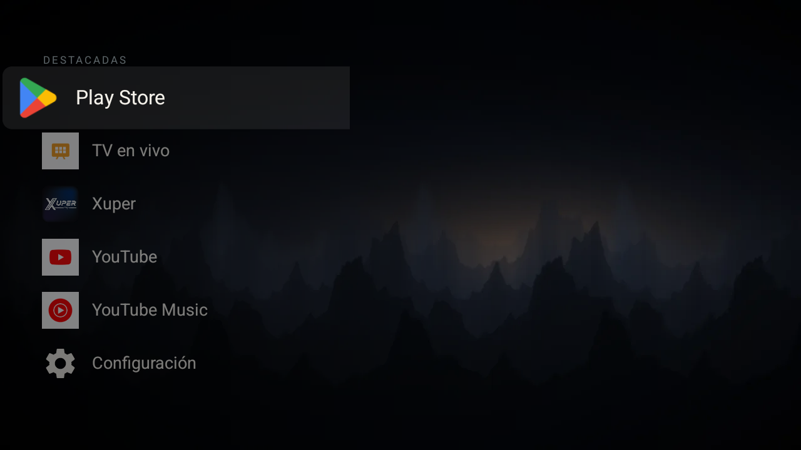

# Minimal TV

A minimal home screen launcher for Android TV, built for low-end sets.

The stock Google TV launcher is designed for devices with far more memory than a budget
TV has. On a set with 1.4 GB of RAM it competes with everything else for memory, and the
home screen feels sluggish. This launcher replaces it with a single vertical list, a
wallpaper, and nothing else: about 160 KB, no ads, no trackers, and no network access at
all.

<p align="center">
  
</p>

## What it does

- **Vertical list** on the left over the wallpaper. The focused row grows and brightens.
- **Typography first.** The app name is bigger than the icon, readable from the sofa.
- **Featured apps** pinned to the top, under a `DESTACADAS` heading. The apps that are
  not featured go under their own `TODAS LAS APPS` heading, so nothing looks featured by
  accident.
- **Settings** is always the last entry.
- **The home button is a starting point**: it always takes the focus back to the first
  app, so the list never opens in the middle.
- **Featured only mode**: hide every app that is not featured, for a launcher that shows
  four things and nothing else.
- **Mountain wallpaper or a solid dark one**, switched from the settings and applied at
  once, without restarting the launcher.
- **Spanish** interface.

## Requirements

- Android 5.0 (API 21) or newer. Built and tested on Android 14.
- A TV. It works on phones too, but the layout assumes a 10-foot UI.

## Install

The launcher is not on the Play Store. Sideload the APK over ADB:

```bash
adb install -r app-release.apk
```

Then make it the home screen. On Android TV the stock launcher and the setup wizard both
register a home activity and win the resolution, so they have to be disabled for the
current user:

```bash
bash herramientas/optimizar.sh          # applies the settings and sets the home app
```

## Building

Requires JDK 17 or newer and an Android SDK with platform 34 and build tools 34.

```bash
export ANDROID_SDK_ROOT=~/.cache/android-sdk
./gradlew :app:assembleRelease
```

The APK lands in `app/build/outputs/apk/release/`. It is signed with the debug key
unless a `keystore.properties` file is present; see `keystore.properties.example`.

To sign with your own key:

```bash
keytool -genkeypair -v -keystore my.keystore.jks -alias my-key \
    -keyalg RSA -keysize 2048 -validity 10000
cp keystore.properties.example keystore.properties
# fill in the path and the passwords
./gradlew :app:assembleRelease
```

`keystore.properties` and any `*.jks` are ignored by git. Never commit them.

## The scripts

| Script | What it does |
|---|---|
| `herramientas/instalar.sh` | Builds the release APK, installs it and sets the home app |
| `herramientas/optimizar.sh` | Turns the system animations off, forces the OpenGL renderer, cleans up background processes and makes this launcher the home screen |
| `herramientas/restaurar.sh` | Puts everything back: original animation scales, no forced renderer, the stock launcher enabled and selected again |
| `herramientas/limpiar-apps.sh` | Removes the apps the user does not want, for the current user only |
| `herramientas/reinstalar-apps.sh` | Brings those apps back from the system image |

Every script takes an optional device serial:

```bash
bash herramientas/optimizar.sh 192.168.1.114:5555
```

### What the optimisation changes

| Setting | Value | Why |
|---|---|---|
| `window_animation_scale` | `0.0` | Window open and close animations become instant |
| `transition_animation_scale` | `0.0` | Same for activity transitions |
| `animator_duration_scale` | `0.0` | Same for the system animator |
| `debug.hwui.renderer` | `skiagl` | Forces OpenGL. The Mali-G31 in these sets has no Vulkan support |
| `com.google.android.apps.tv.launcherx` | disabled for the user | Stops the stock launcher from competing for the home button |
| `com.google.android.tungsten.setupwraith` | disabled for the user | Its recovery activity takes the home button back otherwise |

The original values are stored in `backup/valores-originales.txt` the first time the
optimisation runs, and `restaurar.sh` reads them back. The Google voice assistant lives
in its own package (`com.google.android.katniss`) and is not affected.

`debug.hwui.renderer` is a session property: `setprop` does not survive a reboot, so
run `optimizar.sh` again after restarting the TV. The animation scales are persistent.

## How it is built

Kotlin, one Gradle module, and only two AndroidX dependencies (`recyclerview` and the
annotations it pulls in). No AppCompat, no Material, no Leanback, no Play Services.

| Part | File |
|---|---|
| Home screen | `app/src/main/java/dev/minimaltv/launcher/MainActivity.kt` |
| List composition | `app/src/main/java/dev/minimaltv/launcher/AppEntry.kt` |
| Settings | `app/src/main/java/dev/minimaltv/launcher/SettingsActivity.kt` |
| Featured picker | `app/src/main/java/dev/minimaltv/launcher/FeaturedPickerActivity.kt` |
| Preferences | `app/src/main/java/dev/minimaltv/launcher/SharedPrefsStore.kt` |

The list order lives in `AppListBuilder`, which has no Android dependencies beyond the
drawable type, so it is covered by unit tests. `SharedPrefsStore` takes a
`SharedPreferences` instead of a `Context` for the same reason.

## Tests

```bash
./gradlew :app:testDebugUnitTest
```

22 unit tests cover the list ordering (featured first, alphabetical, accents sorted
correctly), the settings entry always being last, the launcher never listing itself, the
featured-only filter, the focus sizes, and the preferences surviving a new store
instance.

## Privacy

The app declares one permission, `SET_WALLPAPER`, used to put the mountain image on the
system wallpaper so the home screen does not jump when switching apps. It does not
request `INTERNET`, so it cannot send anything anywhere. It only reads the list of
installed apps, and it never writes anything outside its own private directory.

## Licence

MIT. See [LICENSE](LICENSE).
